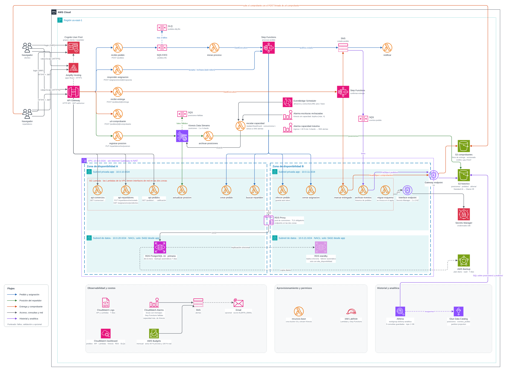

# TP3 — Plataforma de delivery en AWS con Terraform

**82.08 Cloud Computing**



Diagrama editable: [`arquitectura-aws.drawio`](arquitectura-aws.drawio) (se abre con [draw.io](https://app.diagrams.net)). Los colores de las flechas siguen la leyenda: pedido y asignación, posición del repartidor, entrega y comprobante, historial y analítica, y acceso y red.

El módulo raíz de Terraform está en [`terraform/organization/`](terraform/organization/) y el módulo propio en [`terraform/modules/`](terraform/modules/). Hay un archivo por capa de la arquitectura: `network`, `database`, `auth`, `api`, `compute`, `orchestration`, `messaging`, `streaming`, `escalado`, `analitica`, `storage`, `monitoring` e `iam`. Las variables, los outputs, los locals, los providers y las versiones están en archivos separados.

---

## 1. Módulos

### Módulo propio: `terraform/modules/lambda_function`

Encapsula todo lo que necesita una Lambda del proyecto. Se usa **21 veces**: 18 en [`compute.tf`](terraform/organization/compute.tf), 1 en [`recursos-base.tf`](terraform/organization/recursos-base.tf), 1 en [`escalado.tf`](terraform/organization/escalado.tf) y 1 en [`analitica.tf`](terraform/organization/analitica.tf). Así, cada función queda declarada en unas pocas líneas.

| Recurso que crea | Para qué |
|---|---|
| `archive_file.zip` | Empaqueta `lambdas/<nombre>/` en `.build/<nombre>.zip` (excluye `__pycache__`) |
| `aws_cloudwatch_log_group.this` | Log group `/aws/lambda/<nombre>` con retención de 7 días |
| `time_sleep.logs` | Al destruir, espera 60 s antes de borrar el log group (ver [sección 4](#4-lambda-recursos-base)) |
| `aws_lambda_function.this` | La función: Python 3.12, handler `handler.handler`, redeploy automático cuando cambia el código (`source_code_hash`) |

| Variable | Tipo | Default | Descripción |
|---|---|---|---|
| `nombre` | `string` | — | Nombre de la función y del zip |
| `source_dir` | `string` | — | Carpeta con el `handler.py` |
| `role_arn` | `string` | — | Rol de ejecución (`LabRole`) |
| `timeout` | `number` | `10` | Segundos |
| `environment` | `map(string)` | `{}` | Variables de entorno; si está vacío no se crea el bloque |
| `vpc_config` | `object` | `null` | Subredes y security groups; `null` = la función corre fuera de la VPC |
| `layers` | `list(string)` | `[]` | ARNs de layers; tiene una validación de hasta 5, que es el límite de Lambda |
| `concurrencia_reservada` | `number` | `null` | Ejecuciones concurrentes reservadas; `null` = sin reserva. `escalar-capacidad` usa 1 para que dos cambios de shards no se pisen |

Outputs: `function_name`, `arn` e `invoke_arn`. Los consumen API Gateway, Step Functions, los event source mappings y `aws_lambda_invocation`.

### Módulo externo: `terraform-aws-modules/vpc/aws` (`~> 6.7`)

Está en [`network.tf`](terraform/organization/network.tf) y crea la VPC con 2 AZ y dos niveles de subredes privadas. Las subredes `app` alojan las Lambdas que acceden a RDS y las subredes `datos` alojan RDS, con su propio subnet group y una NACL dedicada. Las reglas de la NACL se generan con una expresión `for` sobre las subredes `app`: solo permiten tráfico entrante al 5432 y la respuesta por puertos efímeros. No hay Internet Gateway ni NAT (`create_igw = false`, `enable_nat_gateway = false`). Las Lambdas de la VPC llegan a Secrets Manager y a S3 por VPC endpoints.

---

## 2. Funciones de Terraform

| Función | Dónde | Para qué |
|---|---|---|
| `jsonencode` | `api.tf`, `database.tf`, `messaging.tf`, `compute.tf`, `recursos-base.tf` | Formato de los access logs, secreto de RDS, redrive policy de SQS, input de las invocaciones |
| `jsondecode` | `recursos-base.tf`, `outputs.tf` | Leer la respuesta de `recursos-base` y de `migrar-esquema` |
| `templatefile` | `orchestration.tf` | Generar las definiciones ASL de las dos state machines a partir de `statemachines/*.tftpl` |
| `merge` | `compute.tf` | Sumar variables propias a `local.entorno_db`, que comparten todas las Lambdas que usan RDS |
| `concat` | `compute.tf` | Combinar las layers de base de datos con la layer de API |
| `cidrsubnet` | `locals.tf` | Calcular las subredes /24 `app` (10.0.10+i) y `datos` (10.0.20+i) a partir de `vpc_cidr` |
| `slice` | `locals.tf` | Tomar las 2 primeras AZ disponibles |
| `range` / `length` | `locals.tf` | Generar una subred por AZ |
| `toset` | `locals.tf`, `compute.tf` | Roles de Cognito y layers como conjuntos para `for_each` |
| `values` | `api.tf`, `variables.tf` | Audiencias del autorizador JWT (IDs de los App Clients); validar los grupos de `usuarios_demo` |
| `replace` | `database.tf` | Nombre de la base derivado de `proyecto` (los guiones pasan a `_`) |
| `tostring` | `compute.tf` | Pasar números y booleanos como variables de entorno |
| `filesha256` | `compute.tf` | Volver a correr la migración cuando cambia `schema.sql` o `seed.sql` |
| `strcontains` | `compute.tf` | Postcondición: el bundle de CA de RDS descargado es un certificado |
| `can` + `regex` / `cidrhost` | `variables.tf` | Validar `proyecto`, `alerta_email`, `cors_origenes` y que `vpc_cidr` sea un CIDR válido |
| `contains`, `alltrue`, `endswith` | `variables.tf` | Validar la región, los grupos de usuarios demo y que la VPC sea /16 |

---

## 3. Meta-argumentos

### `for_each`

| Dónde | Itera sobre |
|---|---|
| `auth.tf` | `local.roles` (un App Client y un grupo de Cognito por app) y `var.usuarios_demo` (contraseña, usuario y pertenencia a grupo por cada usuario de prueba) |
| `api.tf` | `local.lambdas_api` (integración y permiso de invocación por Lambda) y `local.rutas` (una ruta del API por entrada) |
| `compute.tf` | Las layers `db` y `api` (zip + `aws_lambda_layer_version`) |
| `streaming.tf` | `local.consumidores_posiciones`: los dos consumidores del stream, cada uno con su posición inicial, tamaño de lote, ventana y edad máxima |
| `monitoring.tf` | `local.colas_con_alarma` y `local.workflows` (una alarma por cola y por state machine) |
| Módulo `lambda_function` | Bloques `dynamic` de `environment` y `vpc_config`, que solo se generan si se pasaron |

### `count`

[`monitoring.tf`](terraform/organization/monitoring.tf): la suscripción por email al topic de alertas se crea solo si `alerta_email` no está vacía (`count = var.alerta_email == "" ? 0 : 1`).

### `depends_on`

Se usa para las dependencias que Terraform no puede inferir de las referencias:

| Dónde | Por qué |
|---|---|
| `compute.tf` (`migrar_esquema`) | La migración necesita RDS, el secreto, el endpoint de Secrets Manager y las reglas de security group ya creadas |
| `streaming.tf` | Kinesis no invoca a `actualizar-posicion` hasta que exista la tabla que escribe, es decir, hasta que corrió la migración |
| `storage.tf` | El lifecycle de S3 necesita el versionado activo; la bucket policy va después del public access block |
| Módulo `lambda_function` | La función se crea después de su log group (vía `time_sleep`) |

### `lifecycle`

| Dónde | Regla | Por qué |
|---|---|---|
| `network.tf`, `database.tf` | `create_before_destroy` en los security groups | Reemplazar un SG sin dejar sin reglas a los recursos que lo usan |
| `database.tf` | `precondition` | RDS necesita al menos 2 subredes de datos |
| `compute.tf` (`data.http.rds_ca`) | `postcondition` | Falla temprano si no se pudo descargar el bundle de CA de RDS |
| `recursos-base.tf` | `lifecycle_scope = "CRUD"` (argumento de `aws_lambda_invocation`) | La invocación corre en create, update y **destroy** |

---

## 4. Lambda `recursos-base`

El Learner Lab tiene un SCP (Service Control Policy de AWS Academy) que niega dos llamadas que el provider de AWS hace siempre y que no se pueden desactivar:

| Recurso | Llamada denegada |
|---|---|
| `aws_s3_bucket` | `s3:GetBucketObjectLockConfiguration`, en cada lectura del bucket. Después del primer apply, todo `plan` falla |
| `aws_kinesis_stream` | `kinesis:IncreaseStreamRetentionPeriod`, al crear el stream. El stream queda a medias y sin cifrado |

Por eso el bucket `archivos` y el stream `posiciones` no se declaran como recursos de Terraform. Los crea una Lambda, [`lambdas/recursos-base/handler.py`](terraform/organization/lambdas/recursos-base/handler.py), que solo hace las llamadas permitidas. Terraform la invoca como un *custom resource*:

```hcl
resource "aws_lambda_invocation" "recursos_base" {
  function_name   = module.recursos_base.function_name
  lifecycle_scope = "CRUD"
  input = jsonencode({ bucket = ..., stream = ..., shards = 1, kms_key = "alias/aws/kinesis", tags = ... })
}
```

| Acción de Terraform | Qué hace la Lambda |
|---|---|
| **create** | Crea el stream (1 shard, `PROVISIONED`, cifrado KMS) y el bucket. Si ya existen, no falla. Las etiquetas (`default_tags` del provider) las aplica si el Lab lo permite |
| **update** | Si cambió el nombre del bucket o del stream, borra el anterior y crea el nuevo |
| **delete** | Vacía el bucket (todas las versiones y delete markers) y lo borra; borra el stream |

La Lambda devuelve los nombres y ARNs. [`recursos-base.tf`](terraform/organization/recursos-base.tf) los expone como `local.bucket_archivos`, `local.bucket_archivos_arn`, `local.stream_posiciones` y `local.stream_posiciones_arn`. El resto del código usa esos locals, y la configuración del bucket (versionado, cifrado, lifecycle, CORS, policy y bloqueo de acceso público) sigue en Terraform, en [`storage.tf`](terraform/organization/storage.tf). El nombre del bucket es único porque lleva un sufijo `random_id`.

**`time_sleep` en el módulo de Lambda.** Lambda escribe los logs unos segundos después de cada invocación. Si el log group ya se borró, lo vuelve a crear fuera de Terraform. Como `recursos-base` se invoca durante el `destroy`, eso rompía el siguiente `apply`. El `time_sleep` hace que el log group se borre 60 s después que la función.

---

## 5. Guía de ejecución

Hay dos formas de desplegar. **No mezclarlas sobre la misma cuenta**: cada una guarda su propio estado de Terraform, y un apply local no ve lo que creó el workflow (ni al revés).

### Requisitos

- Una sesión activa de **AWS Academy Learner Lab**: el código usa el rol `LabRole` y la región `us-east-1`.
- Para la opción B: Terraform **>= 1.10** (el CI usa 1.16.4), AWS CLI y, para el frontend, Node.js.

### Opción A: desde GitHub Actions (recomendada)

1. **Secrets.** En el Learner Lab, *Start Lab* → *AWS Details* → *AWS CLI*. Cargar los tres valores en *Settings → Secrets and variables → Actions* del repositorio:
   `AWS_ACCESS_KEY_ID`, `AWS_SECRET_ACCESS_KEY` y `AWS_SESSION_TOKEN`. Vencen con la sesión del Lab: actualizarlos antes de cada ejecución.
2. **Desplegar.** *Actions* → **deploy** → *Run workflow* → `apply`. Tarda unos 15 minutos (RDS es lo más lento).
   La casilla **`alta_disponibilidad`** elige el perfil: sin marcar, el perfil *Lab*, más barato; marcada, el perfil de *producción*, sin piezas atadas a una sola zona de disponibilidad (ver [Continuidad del negocio](#continuidad-del-negocio)).
   El workflow prepara el estado remoto, aplica el plan y corre una prueba de humo: rechazo sin token (401), login de Cognito con el usuario demo y catálogo de comercios y productos leído desde RDS.
3. **Resultado.** El resumen de la ejecución muestra la URL del API y el User Pool. El artefacto **`frontend-config`** trae el `.env.local` del frontend (solo configuración pública).
4. **Frontend.** Copiar `.env.local` a `frontend/` y:

   ```bash
   cd frontend
   npm ci
   npm run dev      # http://localhost:5173
   ```

   Usuarios demo: `cliente.demo@example.com` y `repartidor.demo@example.com`. Sus contraseñas no se imprimen en los logs; para leerlas, ver [Contraseñas demo](#contraseñas-demo).
5. **Destruir.** *Run workflow* → `destroy`. Se borran todos los recursos del TP y se conserva el bucket del estado.

   > El `destroy` puede tardar 20–40 min: AWS libera las interfaces de red (ENI) de las Lambdas en VPC un rato después de borrar las funciones, y recién entonces se pueden borrar las subredes y el security group. Conviene lanzarlo con al menos 45 min de sesión del Lab por delante. Si la sesión vence a mitad de camino, el estado remoto queda desactualizado y el lock puede quedar tomado: iniciar el Lab, actualizar los secrets, borrar `delivery/terraform.tfstate.tflock` del bucket si quedó, y volver a correr `destroy`. Terraform detecta lo que ya no existe y lo saca del estado.

`plan` muestra los cambios sin aplicar nada.

### Opción B: desde una terminal

1. **Credenciales.** Copiar el bloque de *AWS Details → AWS CLI* en `~/.aws/credentials`, o exportar las variables:

   ```bash
   export AWS_ACCESS_KEY_ID=...
   export AWS_SECRET_ACCESS_KEY=...
   export AWS_SESSION_TOKEN=...
   export AWS_REGION=us-east-1
   ```

2. **Variables (opcional).** Todas tienen default:

   ```bash
   cp terraform/organization/terraform.tfvars.example terraform/organization/terraform.tfvars
   ```

3. **Init, plan y apply.** Al final del apply, Terraform invoca `migrar-esquema`, que crea el esquema y carga los datos de prueba.

   ```bash
   cd terraform/organization
   terraform init
   terraform plan -out=tfplan
   terraform apply tfplan
   ```

4. **Outputs.**

   ```bash
   terraform output                       # URL del API, User Pool, App Clients, bucket, stream...
   terraform output migracion             # resultado de la migracion
   terraform output -json usuarios_demo   # credenciales de los usuarios de prueba
   ```

5. **Frontend.**

   ```bash
   cd frontend
   npm ci
   npm run config   # genera .env.local con los outputs de Terraform
   npm run dev
   ```

6. **Verificar (opcional).** Desde la raíz del repo, con las mismas credenciales: `./scripts/verificar-apply.sh`.

7. **Destruir.** `terraform destroy` desde `terraform/organization`. `recursos-base` vacía y borra el bucket y el stream como parte del destroy.

### Contraseñas demo

Se generan con `random_password` y quedan solo en el estado. Para leerlas de un despliegue hecho con el workflow, desde una terminal con las credenciales del mismo Lab:

```bash
cd terraform/organization
cat > override.tf <<'HCL'
terraform {
  backend "s3" {}
}
HCL
cuenta=$(aws sts get-caller-identity --query Account --output text)
terraform init -input=false \
  -backend-config="bucket=itba-cloud-2026q2-g1-tfstate-${cuenta}-us-east-1" \
  -backend-config='key=delivery/terraform.tfstate' \
  -backend-config='region=us-east-1' \
  -backend-config='encrypt=true' \
  -backend-config='use_lockfile=true'
terraform output -json usuarios_demo
```

`override.tf` está en `.gitignore`. No copiar las contraseñas en issues, PR ni logs.

### Demo de la asignación por tiempo de preparación

La asignación no elige al repartidor más cercano: elige por el momento en que el pedido puede salir del comercio, `max(llegada del repartidor, comida lista)`. Si varios llegan a tiempo, gana el que llega más justo, para que no espere en la puerta. Con dos repartidores se ven los dos casos:

1. Abrir la app del repartidor dos veces, en ventanas que no compartan sesión (una normal y otra de incógnito), con `repartidor.demo@example.com` y `repartidor2.demo@example.com`. A uno ponerle la zona **Pizzeria Demo Centro** y al otro **Sushi Demo Palermo**, ambos en *Simular recorrido* y disponibles. Quedan a ~4 km entre sí.
2. **Pedido a la pizzería** (prepara en 10 min): el de la zona Sushi tardaría ~12 min en llegar y el pedido saldría tarde. Gana el que está al lado.
3. **Pedido al sushi** (prepara en 25 min): los dos llegan a tiempo. Gana el de la pizzería, que llega a los ~12 min; el que está al lado esperaría 25 min en la puerta y queda libre para otro pedido.
4. **Ver el porqué:** Step Functions → `delivery-procesar-pedido` → la ejecución del pedido → paso `BuscarRepartidor` → *Output* → `candidato.evaluados`. La lista muestra, para cada candidato, cuándo llega (`llegada_s`), cuándo está lista la comida (`listo_s`) y cuándo saldría el pedido (`sale_en_s`). Lo mismo queda en los logs de `delivery-buscar-repartidor`.

---

## 6. Pipelines de GitHub Actions

| Workflow | Cuándo corre | Qué hace |
|---|---|---|
| [`terraform.yml`](.github/workflows/terraform.yml) | Cada PR y cada push a `main` | `fmt`, `init -backend=false`, `validate` y, si hay secrets, `plan` contra un estado vacío. En un PR desde un fork GitHub no entrega secrets: el plan se omite con un aviso y el job queda en verde. |
| [`deploy.yml`](.github/workflows/deploy.yml) | Manual (*Run workflow*) | `plan`, `apply` o `destroy` con estado remoto, prueba de humo y artefacto del frontend. Ver [Opción A](#opción-a-desde-github-actions-recomendada). |
| [`tfsec.yaml`](.github/workflows/tfsec.yaml) | Cada PR | Análisis de seguridad del código Terraform. Ver [Decisiones de seguridad](#decisiones-de-seguridad). |
| [`terraform-docs.yml`](.github/workflows/terraform-docs.yml) | Cada PR | Documentación de los módulos. En un PR desde un fork genera sin empujar cambios. |
| [`terraform-format.yml`](.github/workflows/terraform-format.yml) | Cada PR | `terraform fmt -check` con comentario en el PR. |

### Estado remoto del despliegue

[`.github/scripts/terraform-backend.sh`](.github/scripts/terraform-backend.sh) prepara, antes de cada ejecución de `deploy`:

- **Bucket de estado** `itba-cloud-2026q2-g1-tfstate-<cuenta>-us-east-1`: privado (bloqueo de acceso público), cifrado (SSE-S3) y versionado, así que una versión dañada del estado se puede recuperar. Se crea con la AWS CLI y no con Terraform: es el lugar donde Terraform guarda su propio estado, y además el Learner Lab niega la llamada que el provider hace sobre todo bucket (ver [sección 4](#4-lambda-recursos-base)).
- **Bloqueo nativo de S3** (`use_lockfile`): dos ejecuciones nunca escriben el estado a la vez. Además, el workflow encola las ejecuciones y nunca cancela un apply en curso.
- **Protección contra duplicados:** si la cuenta ya tiene recursos `delivery` pero el estado remoto está vacío (por ejemplo, de un apply local), el workflow se detiene en vez de crear un segundo despliegue.

El estado y los planes nunca se publican como artefactos: contienen las contraseñas generadas.

### Decisiones de seguridad

tfsec no reporta hallazgos abiertos. Cada regla que se acepta está marcada con `#tfsec:ignore:<regla>` en el recurso, junto con su justificación; no se desactiva el análisis.

| Regla | Recurso | Por qué se acepta |
|---|---|---|
| `aws-sns-enable-topic-encryption` | `alertas` | CloudWatch Alarms no puede publicar en un topic cifrado con la clave administrada `aws/sns`. Cifrarlo exigiría una CMK propia con key policy a medida. El topic solo transporta nombres y estados de alarmas. |
| `aws-sns-topic-encryption-use-cmk` | `estado_pedido` | Está cifrado con la clave administrada. Solo publican Step Functions y LabRole, que esa clave ya autoriza; una CMK no cambiaría quién puede leer. |
| `aws-rds-enable-deletion-protection` | RDS | El `destroy` del workflow tiene que poder borrar la base sin pasos manuales. En producción iría activado. |
| `aws-rds-enable-iam-auth` | RDS | Las Lambdas usan usuario y clave de Secrets Manager por el endpoint privado de la VPC; la autenticación IAM requiere permisos `rds-db:connect` que LabRole no permite configurar. |
| `aws-rds-enable-performance-insights` | RDS | No disponible para `db.t3.micro`. |
| `aws-ssm-secret-use-customer-key`, `aws-cloudwatch-log-group-customer-key` | Secreto de RDS, log groups | Cifrado con claves administradas. Una CMK no agrega control de acceso cuando todo corre con LabRole. |
| `aws-lambda-enable-tracing` | Módulo `lambda_function` | X-Ray necesita `xray:PutTraceSegments` en el rol de ejecución, y LabRole no se puede modificar. El seguimiento se hace con las ejecuciones de Step Functions y CloudWatch Logs. |

La retención de backups de RDS, que tfsec marcaba en 1 día, pasó a ser la variable `db_dias_backup` (7 días por defecto).

---

## 7. Resiliencia, costos y gobernanza

### Continuidad del negocio

Casi toda la arquitectura ya es multi-AZ sin configurar nada: Lambda, Step Functions, API Gateway, Kinesis, SQS, SNS, Cognito y S3 son servicios regionales que AWS replica entre zonas de disponibilidad, y la VPC tiene subredes en dos zonas. Solo dos piezas pueden quedar atadas a una zona, y las dos son decisiones de costo con un interruptor:

| Pieza | Perfil Lab (por defecto) | Perfil alta disponibilidad |
|---|---|---|
| RDS | Una instancia en una AZ (`db_multi_az = false`) | Standby sincrónico en otra AZ con failover automático (`db_multi_az = true`). Duplica el costo de la instancia |
| Endpoint de Secrets Manager | Una interfaz en una AZ (`endpoint_una_az = true`). Si esa zona cae, las Lambdas de la otra no pueden leer la clave de la base | Una interfaz por AZ (`endpoint_una_az = false`) |

En el workflow de deploy, la casilla `alta_disponibilidad` cambia las dos a la vez. Con Multi-AZ activo, el failover se puede provocar para demostrarlo, mientras se usa la app:

```bash
aws rds reboot-db-instance --db-instance-identifier delivery --force-failover
```

Multi-región no es parte del alcance: el compromiso del TP1 es alta disponibilidad entre zonas. Las estrategias para sobrevivir a una región completa están en la tabla siguiente.


| Estrategia | Cómo se aplica en el TP |
|---|---|
| **Backup & restore** | Dos capas. **Backups automáticos de RDS** (`db_dias_backup`, 7 días): restauración a cualquier punto en el tiempo, con RPO de ~5 minutos (RDS sube los logs de transacciones cada 5 minutos). **AWS Backup** (`backup_rds`): copia diaria en una bóveda propia, que sobrevive aunque se borre la instancia y es la que se puede copiar a otra región o cuenta. |
| **Pilot light** | El propio repositorio: `deploy → apply` reconstruye las 162 piezas de la arquitectura en otra cuenta o región en ~15 minutos. Con una copia de AWS Backup llevada a esa región, la recuperación es "apply + restaurar la base". La infraestructura como código es lo que hace barato tener el piloto apagado. |
| **Hot standby** | `db_multi_az = true`: RDS mantiene una réplica sincrónica en otra AZ y, si la primaria falla, mueve el endpoint en uno o dos minutos sin intervención. Durante el failover se cortan las conexiones abiertas: `db.py` las descarta y reconecta en la siguiente invocación. Queda en `false` por defecto porque duplica el costo de la instancia; se activa para producción o para la demo. |
| **Warm standby / multi-site** | No aplican en el Learner Lab, que limita el trabajo a una región práctica. El camino sería una réplica de lectura de RDS en otra región (warm standby) o Aurora Global Database con la arquitectura desplegada en dos regiones y ruteo de Route 53 (multi-site). |

**AWS Elastic Disaster Recovery** replica servidores (EC2 u on-premise) a nivel de bloque; esta arquitectura no tiene servidores que replicar. **AWS DMS** sirve para migrar o replicar una base de datos desde otro motor u origen; sería la herramienta para traer los datos de un sistema anterior a este RDS, no para su continuidad diaria.

### Escalado según la curva de demanda

El cómputo (Lambda, Step Functions, API Gateway) escala solo con la carga y baja a cero sin pedidos. El único componente con capacidad fija es el **stream de posiciones**, y es el que se escala ([`escalado.tf`](terraform/organization/escalado.tf), variable `escalado`):

| Política | Cómo funciona |
|---|---|
| **Programada** | EventBridge Scheduler, con los cron en hora de Buenos Aires. Al empezar cada franja (almuerzo 11:30, cena 19:30) sube a `shards_pico`. Al terminar (14:30 y 23:00) baja un paso hacia `shards_minimo`, y se repite una y dos horas después, porque Kinesis solo divide a la mitad por llamada. |
| **Reactiva** | Alarma `delivery-posiciones-escrituras-rechazadas`: si Kinesis rechaza escrituras por falta de capacidad (`WriteProvisionedThroughputExceeded`) en 2 de 3 minutos, invoca la Lambda, que duplica los shards hasta `shards_maximo`. Después de escalar, la Lambda devuelve la alarma a OK para que pueda volver a dispararse si la capacidad nueva tampoco alcanza, con **5 minutos de enfriamiento**: la ventana de la alarma todavía incluye los rechazos de antes del escalado, y sin enfriamiento duplicaría de nuevo sin necesidad. |
| **Mínimo operativo** | Fuera de las franjas el stream vuelve a `shards_minimo` (1). |
| **Techo de capacidad** | Alarma `delivery-posiciones-capacidad-maxima` al topic de alertas: avisa cuando el ingreso (`IncomingRecords` e `IncomingBytes`) supera el 80 % de lo que soportan `shards_maximo` shards (1000 registros/s y 1 MiB/s por shard) en 3 de 5 minutos, y avisa de nuevo cuando baja. Además, si la alarma reactiva se dispara con el stream ya en `shards_maximo`, la Lambda avisa que la capacidad máxima no alcanza (cubre el caso de un shard caliente que el promedio no muestra). |

Las dos políticas pasan por la Lambda `escalar-capacidad`, que tiene **concurrencia reservada 1** para que dos cambios no se crucen. La Lambda nunca baja durante un pico (`pico` no reduce) y no hace nada si el stream ya tiene la cantidad pedida. Si el stream está cambiando de tamaño, falla para que Scheduler o la alarma reintenten. Cada cambio de shards se avisa al topic de alertas.

**Límites de Kinesis que definen los valores:** cada llamada solo puede duplicar o dividir a la mitad, y se puede cambiar como mucho **10 veces por día** por stream. Por eso las validaciones exigen `shards_pico ≤ 2 × shards_minimo` y `shards_maximo ≤ 2 × shards_pico`. Con los valores por defecto (1, 2 y 4), el peor día usa 8 cambios. Si se agota el cupo, la Lambda avisa al topic de alertas en lugar de fallar.

**Lo que el Learner Lab no permite:** concurrencia aprovisionada de Lambda (deny explícito) y Application Auto Scaling para Lambda (necesita un rol vinculado al servicio que no se puede crear). Por eso el escalado programado se aplica al stream y no a la concurrencia de las funciones.

**Demo:**

```bash
aws lambda invoke --function-name delivery-escalar-capacidad --cli-binary-format raw-in-base64-out   --payload '{"accion":"pico"}' /dev/stdout       # simula el inicio de una franja
./scripts/simular-pico.sh 240                     # ráfaga > 1000 registros/s: dispara la alarma
aws lambda invoke --function-name delivery-escalar-capacidad --cli-binary-format raw-in-base64-out   --payload '{"accion":"base"}' /dev/stdout       # simula el fin de una franja
```

El dashboard muestra los shards (métrica `delivery/Escalado` → `Shards`, publicada en formato EMF desde los logs) junto a las escrituras rechazadas.

### Historial y panel analítico

Los eventos de posición y del ciclo de vida de los pedidos se archivan de forma continua en S3, y se analizan con SQL desde Athena ([`analitica.tf`](terraform/organization/analitica.tf)).

| Capa | Cómo |
|---|---|
| **Posiciones** | Kinesis → `archivar-posiciones` → `historico/posiciones/fecha=AAAA-MM-DD/`, en lotes. |
| **Eventos de pedidos** | Cada cambio de estado ya se publica en el topic `estado_pedido`. Una cola SQS suscrita los junta y `archivar-eventos` los completa con comercio, repartidor, total y punto de entrega (lee RDS, por eso corre en la VPC) y los escribe en `historico/pedidos/fecha=AAAA-MM-DD/`. Los mensajes que fallan 5 veces van a `eventos-fallidos`, con alarma. |
| **Catálogo** | Base `delivery_analitica` de Glue con las tablas `posiciones` y `eventos_pedido`. Usan *partition projection*: Athena deduce las particiones del nombre de la carpeta, sin crawler de Glue (que necesitaría un rol propio y cobra por ejecución). |
| **Consultas** | Workgroup `delivery-analitica`, con resultados en `athena/` del mismo bucket (se borran a los 7 días) y un tope de datos escaneados por consulta (`athena_limite_escaneo_mb`, 1 GB): Athena cobra por dato leído, y una consulta mal escrita no puede recorrer todo el histórico. |

**Panel.** Las consultas guardadas del workgroup, en [`consultas/`](terraform/organization/consultas/):

| Consulta | Qué responde |
|---|---|
| `tiempos_entrega` | Minutos hasta asignar y hasta entregar, por comercio y hora del pedido |
| `curva_demanda` | Pedidos por día de la semana y hora: la curva que justifica las franjas del escalado |
| `cobertura` | Repartidores por celda de ~500 m y hora: dónde hay flota y dónde falta |
| `desempeno_repartidores` | Entregas, minutos medios de entrega y km recorridos por repartidor |
| `rechazos_cancelaciones` | Pedidos rechazados y cancelados por comercio |

Para usarlo: abrir Athena (output `athena_url`), elegir el workgroup **`delivery-analitica`**, pestaña *Saved queries*, y correr la consulta. Los eventos llegan a S3 con hasta un minuto de demora (`archivo_ventana_segundos`).

**Decisiones:**
- El lifecycle pasa `historico/` a **Glacier Instant Retrieval**, que Athena puede leer directamente; Glacier Flexible Retrieval o Deep Archive dejarían lo más viejo afuera de las consultas.
- El endpoint de S3 de la VPC es de solo lectura salvo `historico/pedidos/`, el único prefijo donde escribe una Lambda de la VPC.
- Los datos se guardan como JSON, simple de escribir y de leer. En producción convendría convertirlos a Parquet (por ejemplo con Firehose o un `CREATE TABLE AS` diario): columnar y comprimido, Athena escanea mucho menos y la consulta cuesta menos.
- En un despliegue real el panel sería QuickSight sobre estas mismas tablas; en el Learner Lab no está disponible.

### Costos

- **AWS Budgets** (`presupuesto_mensual_usd`, 50 USD): presupuesto mensual con dos avisos al topic de alertas: cuando el pronóstico del mes supera el 80 % y cuando el gasto real supera el 100 %. Es por cuenta y no por tags porque en el Learner Lab la cuenta es exclusiva del TP, y el filtro por tags exige activar las *cost allocation tags* en Billing, que el Lab no permite.
- **Etiquetado:** `default_tags` del provider etiqueta todos los recursos con el proyecto. Es la base para separar costos con Cost Explorer en una cuenta compartida.
- **Decisiones de diseño por costo:** sin NAT Gateway (los servicios se alcanzan por endpoints de VPC o desde Lambdas fuera de la VPC), `db.t3.micro`, un shard de Kinesis fuera de las franjas de pico (un segundo shard durante unas 6 h por día cuesta unos 0,09 USD), lifecycle del histórico a Standard-IA y Glacier IR, y todo el cómputo serverless: si no hay pedidos, casi no hay costo.

### Monitoreo

- **Dashboard** `delivery-operacion` (output `dashboard_url`): en una sola pantalla, los pedidos (ejecuciones de las dos state machines), la API (pedidos, errores 4xx/5xx y latencia p90), los errores y throttles de todas las Lambdas, el ingreso a Kinesis, sus shards y escrituras rechazadas, el atraso de sus consumidores, conexiones y CPU de RDS, y las colas de fallidos.
- **Alarmas** al topic `alertas`: mensajes en las colas de fallidos, ejecuciones fallidas de cada workflow, cada cambio de shards del stream (lo avisa la Lambda de escalado), el uso cercano a la capacidad de `shards_maximo`, los rechazos con el stream ya en el máximo, y el presupuesto. La alarma de escrituras rechazadas no avisa por email: dispara el escalado y se rearma cada minuto mientras dura un pico.
- **CloudTrail:** el historial de eventos de los últimos 90 días está activo por defecto en toda cuenta y alcanza para auditar quién creó o cambió qué. No se crea un trail propio porque necesitaría otro bucket S3, que en este Lab hay que crear fuera del provider (ver [sección 4](#4-lambda-recursos-base)).

### Gobernanza en producción

La cuenta del Learner Lab es administrada por AWS Academy, así que estos servicios no se pueden configurar desde el TP. En un despliegue real:

| Servicio | Uso |
|---|---|
| **AWS Organizations + Control Tower** | Una cuenta por ambiente (desarrollo, staging, producción) bajo una landing zone, con guardrails comunes. |
| **AWS Config** | Reglas que verifican continuamente lo que hoy revisa tfsec en cada PR: buckets sin acceso público, cifrado en reposo, backups habilitados, tags obligatorios. |
| **Trusted Advisor** | Recomendaciones de costo y seguridad sobre la cuenta (las completas requieren plan de soporte Business). |
| **Cost Explorer** | Análisis del gasto por servicio y por tag. |
| **Systems Manager** | Parameter Store para configuración y, si hubiera instancias, parches y acceso sin SSH. En una arquitectura serverless su uso es acotado. |
| **Resource Groups / Tag Editor** | Ver y operar todos los recursos del proyecto juntos a partir de sus tags. |

### Well-Architected

| Pilar | Decisiones del TP |
|---|---|
| **Excelencia operativa** | Infraestructura como código, despliegue desde el pipeline con prueba de humo, dashboard, alarmas, logs con retención definida. |
| **Seguridad** | Cognito con grupos por rol y autorizador JWT, base en subred privada sin acceso público, credenciales en Secrets Manager por endpoint privado, TLS obligatorio en S3, cifrado en reposo, tfsec en cada PR con las excepciones justificadas. |
| **Fiabilidad** | Reintentos con backoff y colas de fallidos, idempotencia (`crear-pedido`, nombre de ejecución por pedido), restricciones en la base que impiden estados inválidos (un pedido asignado por repartidor), reconexión a RDS, Multi-AZ y dos capas de backup. |
| **Eficiencia de rendimiento** | Serverless con escalado automático, stream de posiciones con escalado programado por franjas y reactivo por alarma, búsqueda de repartidores cercanos con índice GiST de PostGIS y elección según cuándo llega cada uno frente al tiempo de preparación del comercio, Kinesis para absorber el volumen de posiciones sin presionar la base. |
| **Optimización de costos** | Pago por uso, sin NAT Gateway, instancias mínimas, lifecycle del histórico, presupuesto con alertas. |
| **Sostenibilidad** | Sin servidores ociosos: los recursos de cómputo solo consumen mientras hay pedidos. |
